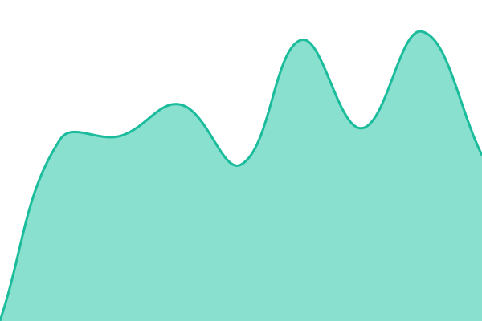

# [📈 Live Status](https://demo.upptime.js.org): <!--live status--> **🟧 Partial outage**

This repository contains the open-source uptime monitor and status page for [Kenny Lin](https://demo.upptime.js.org), powered by [Upptime](https://github.com/upptime/upptime).

With [Upptime](https://upptime.js.org), you can get your own unlimited and free uptime monitor and status page, powered entirely by a GitHub repository. We use [Issues](https://github.com/fjtraindriver/all-status/issues) as incident reports, [Actions](https://github.com/fjtraindriver/all-status/actions) as uptime monitors, and [Pages](https://demo.upptime.js.org) for the status page.

<!--start: status pages-->
<!-- This summary is generated by Upptime (https://github.com/upptime/upptime) -->
<!-- Do not edit this manually, your changes will be overwritten -->
<!-- prettier-ignore -->
| URL | Status | History | Response Time | Uptime |
| --- | ------ | ------- | ------------- | ------ |
|  CLI Proxy API | 🟩 Up | [cli-proxy-api.yml](https://github.com/fjtraindriver/all-status/commits/HEAD/history/cli-proxy-api.yml) | 

 293ms
     
 | 

<a href="https://fjtraindriver.github.io/all-status/history/cli-proxy-api">100.00%</a>
    

|  New-API | 🟥 Down | [new-api.yml](https://github.com/fjtraindriver/all-status/commits/HEAD/history/new-api.yml) | 

 253ms
     
 | 

<a href="https://fjtraindriver.github.io/all-status/history/new-api">0.00%</a>
    

|  Vaultwarden Service | 🟥 Down | [vaultwarden-service.yml](https://github.com/fjtraindriver/all-status/commits/HEAD/history/vaultwarden-service.yml) | 

 409ms
     
 | 

<a href="https://fjtraindriver.github.io/all-status/history/vaultwarden-service">0.00%</a>
    

|  Brintools API Service | 🟩 Up | [brintools-api-service.yml](https://github.com/fjtraindriver/all-status/commits/HEAD/history/brintools-api-service.yml) | 

 505ms
     
 | 

<a href="https://fjtraindriver.github.io/all-status/history/brintools-api-service">100.00%</a>
    

|  XPay管理后台 | 🟩 Up | [x-pay.yml](https://github.com/fjtraindriver/all-status/commits/HEAD/history/x-pay.yml) | 

 3128ms
     
 | 

<a href="https://fjtraindriver.github.io/all-status/history/x-pay">97.78%</a>
    

|  XPay Payin | 🟩 Up | [x-pay-payin.yml](https://github.com/fjtraindriver/all-status/commits/HEAD/history/x-pay-payin.yml) | 

 1065ms
     
 | 

<a href="https://fjtraindriver.github.io/all-status/history/x-pay-payin">97.83%</a>
    

|  XPay Payout | 🟩 Up | [x-pay-payout.yml](https://github.com/fjtraindriver/all-status/commits/HEAD/history/x-pay-payout.yml) | 

 1155ms
     
 | 

<a href="https://fjtraindriver.github.io/all-status/history/x-pay-payout">97.87%</a>
    

<!--end: status pages-->

[**Visit our status website →**](https://demo.upptime.js.org)

## 📄 License

- Powered by: [Upptime](https://github.com/upptime/upptime)
- Code: [MIT](./LICENSE) © [Anand Chowdhary](https://anandchowdhary.com)
- Data in the `./history` directory: [Open Database License](https://opendatacommons.org/licenses/odbl/1-0/)
